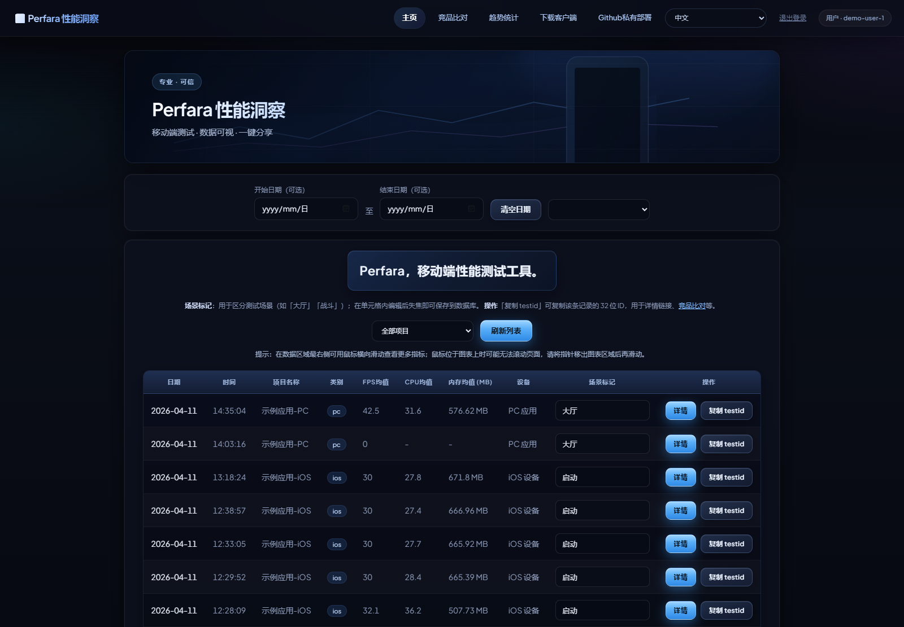
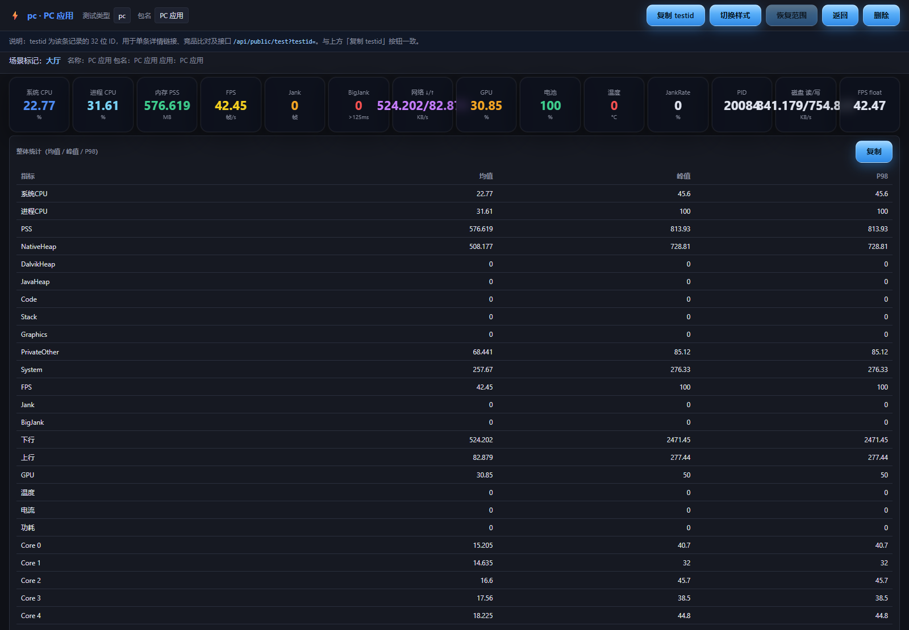
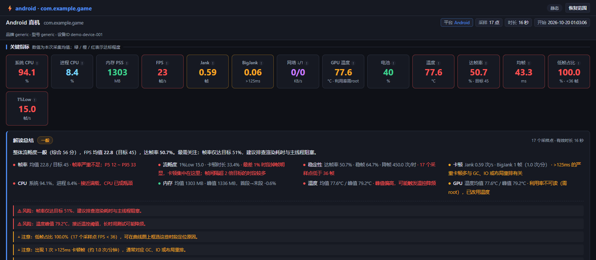
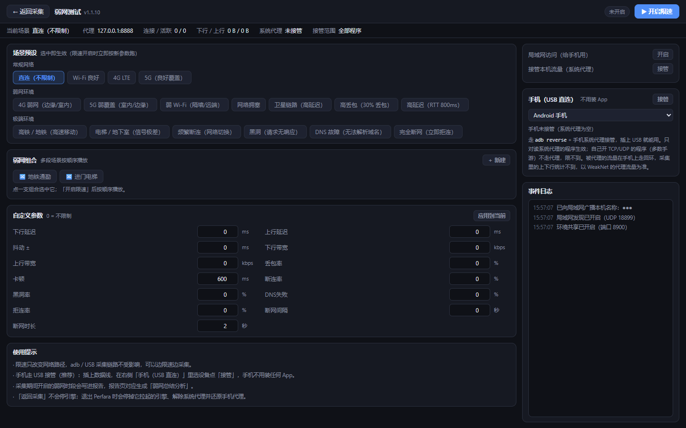

# Perfara


**完全离线的移动端 / PC 端性能测试工具**，对标 PerfDog，并补充 iOS 渲染管线专项数据。

采集全程走本地 USB（或局域网 adb）直连设备，报告在本地看板与单文件 HTML 中查看——
**不登录账号、不上传数据、不依赖任何云服务**，装好即用，断网也能跑。

[下载最新版](https://github.com/45944831/perfara/releases/latest) ·
[操作手册](docs/操作手册-采集与报告.md) ·
[更新日志](docs/更新日志.md)

---

## 快速开始

1. 到 [Releases](https://github.com/45944831/perfara/releases) 下载最新便携版
   （当前 `Perfara_Portable_20261102_r18.zip`，约 212 MB；**exe 与 zip 不入库**，只在这里分发）
2. 解压到任意目录（路径不要含特殊字符），双击 **`Perfara.exe`**
3. 启动器自动拉起本地看板（`127.0.0.1:8000`）与采集客户端
4. 手机开启 USB 调试 → 客户端选设备、选应用 → 点「开始」

无需安装 Python / Node，卸载直接删目录。三步采集、常见问题见下文。

---

## 功能一览

| 模块 | 能力 |
| --- | --- |
| **Android 采集** | USB 直连或无线 adb，Android 6.0+；应用列表走 `pm list packages -3`，**不在手机上装任何 APK**；下拉框显示桌面应用名（解析 APK 的 `AndroidManifest.xml` + `resources.arsc`） |
| **iOS 采集** | 真机 CPU / 内存 / FPS / 网络 / 电量 / 温度；便携版自带 `ios.exe` + Python + `pymobiledevice3`，无需自行安装 |
| **iOS GPU 专项** | 渲染管线细分：GPU 占用、带宽、纹理、着色器、缓存、ALU 等 |
| **PC 采集** | 按进程采集本机 CPU / 内存 / GPU / 磁盘 / 线程 |
| **帧率与流畅度** | FPS / Jank 分级、达帧率、均帧、1%Low、Drop、稳帧范围、Stutter 等 PerfDog 口径指标；目标帧率由 P95 自动吸附 30–165 Hz |
| **系统指标** | CPU（系统 / 进程 / 核心频率 / 限频）、内存分项、网络上下行、GPU 使用率与温度、机身温度、电池、磁盘 I/O、上下文切换、线程数 |
| **弱网测试** | 随包内置 WeakNet 引擎：17 个内置场景 + 出厂 5 支自定义场景 + 13 项自定义参数 + 弱网组合；可限本机、USB 接管手机或同 Wi-Fi 手机 |
| **报告与看板** | 单文件离线 HTML（echarts 与数据全内联）、报告库、最多 6 份对比、框选区间重算、指标口径内置 |
| **停止即出 Excel** | 采集结束自动在报告目录生成 `.xlsx`：汇总 + 每个性能组独立标签页 + 标记区间统计 + 原始采样；零依赖生成，表头冻结可筛选，未测值留空 |

> **进程 CPU 口径**：与 PerfDog / 任务管理器一致，为「占**单核**百分比」——单核跑满 100%，多线程应用可超过 100%
> （上限 N×100%）。`v1.0` 及更早的报告是按整机百分比算的，两者不可直接对比。

### 帧率指标说明

除基础 FPS / Jank 外，还提供达帧率、均帧 Avg(FTime)、帧耗时标准差 / 方差、低帧占比、
1%Low、Drop、FPS≥目标、稳帧范围、Stutter、Jank/BigJank/SmallJank/TinyJank（每 10 分钟归一化）。

**加载阶段自动排除**：冷启动、换场景、读关卡时连续几秒掉到个位数的帧率，会被判定为加载段并剔除
（连续 ≥3 点低于目标帧率 50%，且 5 秒内回到 80% 以上）；持续低帧不剔除，剔除超 40% 整段作废；
曲线用琥珀色底纹标出排除区间，统计表保留 `FPS(全程)` 行对照。

### 弱网测试

- 采集窗口里点 `≈ 弱网测试` 打开覆盖式二级页面，引擎无窗口随包启动，返回采集不停限速
- 17 个内置场景（常规 / 弱网 / 极端）+ 13 项参数（延迟、抖动、带宽、丢包、断连、卡顿、黑洞、拒连、DNS 故障）
- 场景区末尾另有一组**自定义场景**（引擎出厂带 5 支：地铁刷视频卡顿 / 秒杀抢购拥塞 / 视频通话卡顿 / 超低速 100K / 极限丢包闪断），点一下即切换
- **弱网组合**：多段场景按顺序排时间线（最多 5 段、可循环），与 WeakNet 图形界面共用同一份配置；组合名最多 10 个字（与引擎 `name_max` 一致，按字符数算，emoji 也算 1 个）
- 三种接管：本机系统代理、手机 USB 直连（`adb reverse` + 写手机代理，手机不装 App）、同 Wi-Fi 手机
- `■ 停止弱网` 结束引擎并解除代理；`⏸ 暂停` 保留引擎热备；退出程序先收限速与代理再结束引擎
- 报告自动带「弱网总结分析」：弱网时长占比、场景 / 时段 / 接管范围、弱网段 vs 直连段六项对比与风险建议

---

## 界面预览

> 截图取自本项目真实运行界面，未做美化替换。采集窗口与看板顶部各有一行小字署名：
> 本项目基于 [charmingLitteDeveloper/perfara](https://github.com/charmingLitteDeveloper/perfara) 二次开发。

**本地看板**：按日期、项目筛选记录，列表给出 FPS / CPU / 内存均值与场景标记



**测试详情**：「整体统计」给出均值 / 峰值 / P98，各指标分卡展示



**报告页**：关键指标卡 + 自动解读（综合评分、达帧率缺口、卡顿归因、风险与优化提示）



**弱网二级页面**：采集窗口内调场景与参数，状态条给代理地址、连接数与上下行



更多截图见 [`docs/screenshots/`](docs/screenshots)。

---

## 离线是怎么做到的

| 环节 | 实现方式 |
| --- | --- |
| 采集 | `adb shell` / iOS 工具链直连，读 `dumpsys`、`/proc`、`SurfaceFlinger --timestats`、`gfxinfo framestats` |
| 看板服务 | FastAPI 只监听 `127.0.0.1:8000` |
| 数据存储 | 本地 SQLite 与 JSON，随包携带、可整包拷走 |
| 报告 | 单文件 HTML，echarts 与数据全部内联，微信 / 邮件直接转发 |
| 授权 | 无激活码、无联网校验、无试用时长限制 |
| 依赖 | 内置 Electron、Python、adb、iOS 工具链 |

> 一句话：拔掉网线，功能一个都不少。

---

## 构建与测试

改了采集器源码必须重跑 `tools/build_app.py` 重建 `app.asar`；改了 `backend/` 或 `frontend/dist`
必须重打 `server/PerfaraServer.exe`，否则发布包会落后于源码。

```bash
# 重建 app.asar（瘦身规则内置）
python tools/build_app.py

# 重打便携版启动器（产物 build/portable-dist/Perfara.exe）
python -m PyInstaller --onefile --noconsole --name Perfara \
  --icon "$PWD/_client_src/app/icon/perfara.ico" \
  --distpath build/portable-dist --workpath build/portable-work \
  --specpath build/portable-spec --noconfirm tools/launcher_portable.py

# 重打后台服务（产物 perfara/dist/PerfaraServer.exe）
cd perfara && ../tools/.venv/Scripts/python.exe -m PyInstaller perfara_server.spec --noconfirm

# 回归：深度套件按真实退出码汇总，任一套红即 exit 1
bash perfara/tests/run_deep_batch.sh
bash perfara/tests/run_offline_batch.sh

# 发布前两道门禁（都退出码 0 才可发）
python tools/scan_package.py <待发包.zip>
python tools/scan_seed_db.py  <包内 PerfaraServer.exe>
```

工具清单、测试用例说明见 [`docs/`](docs)，当前目录结构：

| 目录 | 说明 |
| --- | --- |
| `_client_src/app/` | Electron 采集客户端源码（`main.js` / `renderer/` / `src/`） |
| `perfara/backend/` | 看板服务端 API（FastAPI + SQLite） |
| `perfara/frontend/` | Web 看板前端与 SPA 后处理脚本 |
| `perfara/collector/resources/reports/` | 报告模板（`perf.html` / `library.html`） |
| `perfara/tests/` | 回归测试脚本（代码资产，禁止清理） |
| `tools/` | 构建、打包、审计脚本 |
| `docs/` | 操作手册、测试报告、截图、更新日志 |

---

## 常见问题

**Q：检测不到设备？**
A：确认 USB 调试已开启并授权；Windows 检查设备管理器里的 ADB 驱动；无线调试需同网段。
若用了 Escrcpy 等自带 adb 的工具，可能抢占 5037 端口，用 `netstat -ano | findstr 5037` 确认归属。

**Q：报告里达帧率、均帧、低帧占比是空的？**
A：这组指标依赖目标帧率（由帧率 P95 推出）。采集期间应用没渲染（后台 / 锁屏 / 被切走）时
FPS 全为空，整族指标无从计算；报告会显式提示，客户端也会弹提示条。

**Q：iOS 采集需要什么？**
A：工具链已内置；Windows 建议安装 Apple 驱动（iTunes 或「Apple 设备」）让手机被识别，
首次连接在手机上点「信任此电脑」。iOS 17+ 走本机隧道，客户端自动建立。

**Q：仓库里为什么没有 exe？**
A：运行时体积远超 GitHub 单文件限制，通过 `.gitignore` 排除，完整可执行文件只以 Release 资产分发；
仓库已停用 Git LFS，clone 约 5.5 MB。

**Q：采集数据会上传到哪？**
A：不离开本机。服务只监听回环地址，数据存本地 SQLite，报告是本地 HTML。

---

## 版本号规则

自下一个版本起改用**序列式版本号**，方便维护、不再和日期绑定：

```
1.0 → 1.1 → … → 1.9 → 1.10 → 2.0 → 2.1 → … → 2.10 → 3.0 → …
```

- 格式为 `主版本.次版本`；次版本从 `0` 到 `10`，用满后主版本进 1、次版本归 0（`1.10` 的下一版是 `2.0`）。
- Release tag 与界面标题栏都用 `v` + 版本号，例如 `v1.10`；程序启动时静默检查一次，有新版时顶栏出现可点击的「新版本」，**不弹窗**。
- 发版时不要手改版本号：
  - **首个序列版本 `v1.0`**：`python tools/make_release_zip.py full <源目录> <输出.zip>`（不传参，沿用源码常量 `1.0`）。
  - **之后每次发新版**：追加 `--app-version=next`，脚本按规则递增、写 `collector/resources/version.txt`、回写源码常量 `APP_VERSION`，并打印本次应使用的 tag。
  - **补发/重打某个已发布版本**：`--app-version=1.3` 显式指定（只写包内版本标识，不改源码）。
  - 日期式版本号（`2026.11.02` / `20261102`）已停用，脚本会直接拒绝。
- **历史 Release（`v2026.*` / `2026xxxx`）是日期式旧编号，保留不改名**。客户端只识别序列式 tag，旧 tag 一律忽略，避免把历史包误报成「新版本」。
- ⚠️ 旧日期式客户端的版本比较逻辑认不出序列式 tag（会判成"更旧"），因此装了历史版本的用户需要手动去 Releases 下载一次 `v1.0`；之后即可正常收到新版提示。

## 版本历史

> 下表是已发布的历史版本，沿用当时的日期式编号；新编号规则见上节，自 `v1.0` 起启用。

| 版本 | 内容 |
| --- | --- |
| `v1.1` | 采集源审计：合并 5 处重复采集（一个周期 shell 命令 10 → 5）、进程 CPU 改单核口径、内存分项统一 App Summary、网络补 `clat*` / `v4-*` |
| `v1.0` | 指标顺序可调、新版本提示、序列式版本号、前台应用自动选中、弱网自定义场景、退出清理 adb |
| `v2026.11.02`（r18） | 弱网停止即结束引擎，修掉四条进程残留路径 |
| `v2026.10.30`（r17） | 真机 USB 接管验收；弱网残留收口、启停合并、引擎加固 |
| `v2026.10.29` | 弱网组合、弱网二级页面、报告「弱网总结分析」 |
| `v2026.10.28` | 深度测试修复轮（D1–D18、N1–N9） |
| `v2026.10.27` | 修复种子数据库泄漏（严重） |

完整变更明细与逐版本修复清单见 [**docs/更新日志.md**](docs/更新日志.md)。

> 早期发布（`v2026.10.23` 及更早）的资产已全部下架：最早的三个包内含未脱敏示例数据
> （真实设备序列号、机型、应用包名），`v2026.10.23` / `.1` 则把开发库编进了 `PerfaraServer.exe`。
> 自 `v2026.10.27` 起，随包种子库改为脱敏版，且缺文件时直接中止打包；
> 每次发布前必须跑完上文两道门禁。

---

## 说明

- 本工具只读取系统公开的性能计数器，不采集应用内业务数据、不抓包、不读取用户文件。
- 请仅对自己有权测试的设备与应用使用。
- 报告模板在仓库内，修改后即时生效，无需重新打包。
- 采集产生的历史数据（`reports/history/`、`perfara/data/`）属本地数据，不入库。
