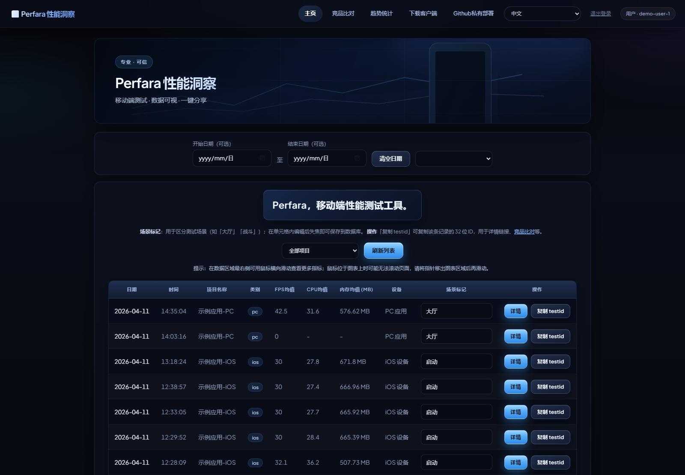
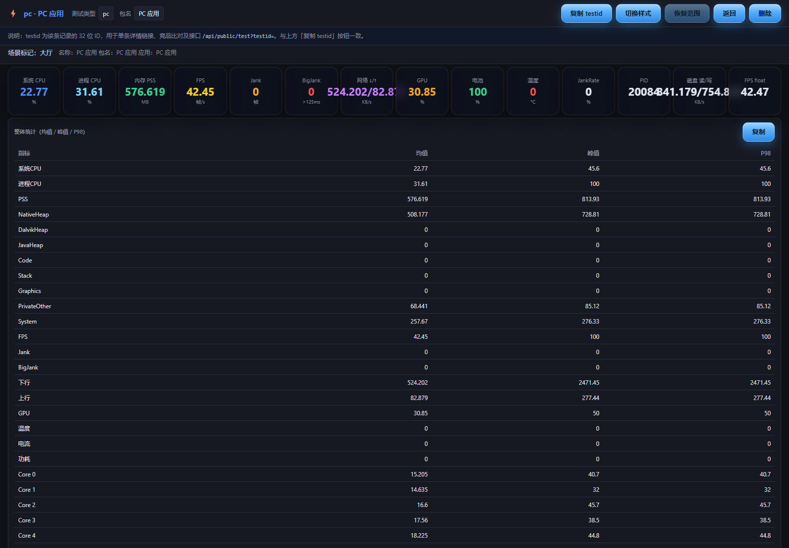
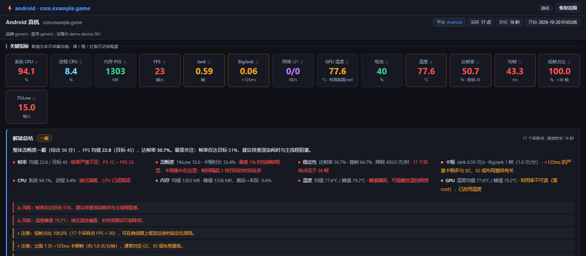
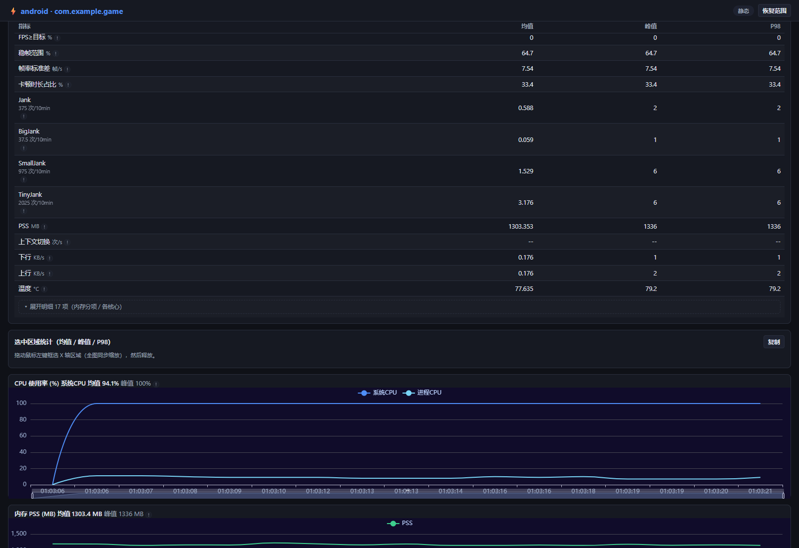
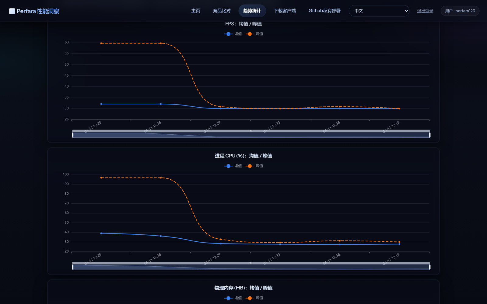

# Perfara


**一款完全离线的移动端 / PC 端性能测试工具**，对标 PerfDog，并补充了 iOS 渲染管线专项数据。

采集全程走本地 USB（或局域网 adb）直连设备，报告在看板与本地单文件 HTML 中查看——
**不登录账号、不上传数据、不依赖任何云服务**，装好即用，断网也能跑。

---

## 为什么是「离线」项目

| 环节 | 实现方式 |
| --- | --- |
| 采集 | `adb shell` / iOS 工具链直连设备，读取 `dumpsys`、`/proc`、`SurfaceFlinger --timestats`、`gfxinfo framestats` 等系统计数器 |
| 看板服务 | FastAPI 跑在 `127.0.0.1:8000`，只监听本机回环地址 |
| 数据存储 | SQLite（`perfara/data/webperf.db`）与本地 JSON，全部留在本机，随包携带、可整包拷走 |
| 报告 | 单文件 HTML，echarts 与数据全部内联，双击即可离线打开、微信/邮件直接转发 |
| 授权 | 无激活码、无联网校验、无试用时长限制 |
| 依赖 | 便携版自带 Electron 运行时、Python 运行时、adb、iOS 工具链，**无需安装 Python / Node** |

> 一句话：拔掉网线，功能一个都不少。

---

## 界面预览

> 以下截图均取自本项目真实运行界面（真机采集数据 + 本地看板 / 本地报告），未做美化替换。

**本地看板**：项目 / 测试列表，按日期、项目、场景标记筛选，一键复制 32 位分享令牌



**测试详情**：FPS、Jank、进程 / 系统 CPU、物理内存、线程数、磁盘读写分卡展示，「整体统计」给出均值 / 峰值 / P98



**报告页**：关键指标卡 + 自动解读总结（综合评分、达帧率缺口、卡顿归因、风险与优化提示）



**报告页曲线**：FPS 与分级卡顿、网络上下行、GPU 温度、设备温度同屏联动



**趋势统计**：同场景多次测试的均值 / 峰值曲线，用于持续观测与防劣化



---

## 功能特性

### 多平台采集

- **Android**：USB 直连或无线 adb，Android 6.0+（FPS 走 `SurfaceFlinger --timestats`，需 Android 11+，低版本自动回退 `gfxinfo`）；应用列表走 `pm list packages -3`，**不在手机上安装任何 APK**
- **iOS**：真机性能采集，含 CPU / 内存 / FPS / 网络 / 电量 / 温度；便携版自带 `ios.exe` + Python + `pymobiledevice3` 工具链，无需自行安装 Python
- **iOS GPU 专项**：渲染管线细分数据（GPU 占用、带宽、纹理、着色器、缓存、ALU 等）
- **PC**：按进程采集本机 CPU / 内存 / GPU / 磁盘 / 线程等指标

### 帧率与流畅度（PerfDog 同口径）

除了基础的 FPS / Jank，还提供整套派生指标：

| 指标 | 口径 |
| --- | --- |
| 达帧率 | 平均 FPS ÷ 目标帧率 |
| 均帧 Avg(FTime) | 各采样点帧间隔（1000/FPS）的均值 |
| 帧耗时标准差 / 方差 | Std(FTime) / Var(FTime) |
| 低帧占比 | FPS 低于目标 80% 的采样占比 |
| 1%Low | 帧耗时最长 1% 的均值折算帧率 |
| Drop | 相邻两点下降 > 8 帧的次数，按小时折算 |
| FPS≥目标 | 达到目标帧率的采样占比 |
| 稳帧范围 MedRange | 偏离中位数 ±20% 内的占比 |
| Stutter | 帧间隔 > 2×目标帧间隔的时间占比 |
| Jank / BigJank / SmallJank / TinyJank | 分级卡顿帧数，并给出**每 10 分钟**归一化次数 |

> 目标帧率由帧率分布 P95 自动吸附到 30/45/60/90/120/144/165，无需手工配置。

### 系统指标

CPU（系统 / 进程 / 各核心使用率与频率 / **CPU 限频**）、内存（PSS、Java Heap、Native Heap、Code、Graphics…）、
网络上下行、GPU 使用率、GPU 温度、机身温度、电池（电量 / 电压 / 电流 / 功耗）、磁盘 I/O、
**上下文切换**、线程数、系统事件。

### 报告与看板

- **单文件离线报告**：`perf.html`，内联 echarts + 数据，可离线打开、转发、归档
- **报告库**：`library.html` 汇总历次报告，支持按设备 / 应用筛选
- **指标对比**：最多 6 份报告同屏对比（可保存为独立的自包含对比报告）
- **指标说明内置**：每个指标的算法口径、单位、优劣方向都写在报告页里，看数不靠猜
- **采集参数可按组裁剪**：不要的指标组直接关掉，既省 adb 开销，报告里也不占版面
- **框选区间重算**：拖动图表区间，统计表按选区重新计算

---

## 本次新增（v2026.10.20）

- **移除 APK 依赖**：删除 `perfara.apk` 的安装与广播拉取应用列表逻辑，应用列表统一走 `pm list packages -3`。
  采集全部通过 USB + adb 读取，手机上不装任何东西，发布包减小 5.4MB。
- **修复打包版「点开始立即停止」**：`lazy()` 的相对路径基准由 `src/` 改为 app 根目录。
  原先 `./src/collector` 被解析成 `src/src/collector`，导致五个采集模块在打包版里全部加载失败，
  Android / iOS / PC 三条链路都起不来。
- **启动失败不再静默**：日志面板被隐藏时，失败原因也会直接显示在界面上。
- **无渲染层保护**：连续 5 秒 `fps=0` 时弹出提示条（应用不在前台 / 没有渲染层）；
  报告统计表补「帧率质量」空状态说明行，不再让整族帧率指标静默消失。
- **回归测试补强**：新增 `lazy_module` 相对路径用例（24 项）、`perf_html` 全 0 帧用例（19 项）、
  `report_serialize_bench` 序列化基准。

---

## 下载与运行

前往 [**Releases**](https://github.com/45944831/perfara/releases) 下载最新便携版：

```
Perfara_Portable_20261020_r5.zip   （约 224MB）
```

1. 解压到任意目录（路径不要含特殊字符）
2. 双击 **`Perfara.exe`**
3. 启动器会自动拉起本地看板（`127.0.0.1:8000`）与采集客户端

无需安装，无需 Python / Node 环境，卸载直接删目录。

### 三步开始采集

1. 手机开启 **USB 调试**，连上电脑，在手机上点「允许调试」
2. 客户端里选择设备 → 选择应用 → 点「开始」
3. 采集结束后打开本地报告（或到看板查看历史 / 做对比）

> 采集期间请保持被测应用在前台。应用切到后台后系统不再产生渲染层，FPS / Jank 采不到，
> 客户端会弹出橙色提示条——这不是工具故障，切回前台即可恢复。

---

## 目录结构

| 目录 | 说明 |
| --- | --- |
| `_client_src/app/` | Electron 采集客户端源码（`main.js` / `renderer/` / `src/` 采集器） |
| `perfara/backend/` | 看板服务端 API（FastAPI + SQLite） |
| `perfara/frontend/` | Web 看板前端（Vue + Vite） |
| `perfara/collector/resources/reports/` | 报告模板（`perf.html` / `library.html`，入库，改完即时生效） |
| `perfara/tests/` | 回归测试脚本（25 套，属代码资产，禁止清理） |
| `docs/screenshots/` | README 界面预览截图（取自本项目真实运行界面） |
| `tools/` | 构建与维护脚本 |
| `build/` | 启动器 PyInstaller 构建配置（`.spec`） |

## 构建与工具

| 脚本 | 用途 |
| --- | --- |
| `tools/build_app.py` | 打包 `app.asar`，带瘦身规则（剔除 echarts 冗余、调试镜像等，73MB → 4.0MB） |
| `tools/asar_tool.py` | asar 解包 / 打包 / 列文件（纯 Python，不依赖 Node） |
| `tools/make_release_zip.py` | 生成发布包（`changes` 改动文件 / `full` 完整便携版） |
| `tools/cleanup_workspace.py` | 清理备份副本与构建中间产物（默认 `--dry-run`；`perfara/tests` 等回归资产在 PROTECTED 白名单内，永不清理） |
| `tools/inject_metric_info.py` | 报告页指标说明注入 |
| `tools/optimize_report_readability.py` | 报告可读性样式优化 |

改了采集器源码后**必须**重跑 `tools/build_app.py` 再打包，否则发布包里的 `app.asar` 会落后于源码。

## 回归测试

```bash
# 后端接口（需先起一个临时服务，见脚本头部说明）
python perfara/tests/test_api_full.py

# 报告页 / 采集页 UI（playwright-core + 本机 Edge 无头）
node perfara/tests/e2e_metric_config/run_perf_html_test.js
node perfara/tests/e2e_metric_config/run_collector_pages_test.js

# 算法与报告数据（jank / 去重 / 分组 / 对比 / 序列化 / 渲染）
node perfara/tests/realdevice/jank_algo_test.js
node perfara/tests/realdevice/lazy_module_test.js
```

## 常见问题

**Q：报告里达帧率、均帧、低帧占比是空的？**
A：这组指标依赖目标帧率，而目标帧率由帧率分布 P95 推出。若采集期间应用没有渲染（后台 / 锁屏 / 被切走），
FPS 全为 0，整族指标就无从计算。现在报告会显式提示「本次采集未取到有效帧」，客户端也会弹提示条。

**Q：检测不到设备？**
A：确认 USB 调试已开启并授权；Windows 可检查设备管理器里的 ADB 驱动；无线调试需与手机同网段。

**Q：iOS 采集需要什么？**
A：便携版已自带 iOS 工具链（`ios.exe` + Python + `pymobiledevice3`），不需要装 Python。
Windows 上建议安装 Apple 驱动（iTunes 或「Apple 设备」应用）让手机被系统识别；首次连接需在手机上点「信任此电脑」。
iOS 17+ 走本机隧道（`127.0.0.1:60105`），客户端会自动建立。

**Q：仓库里为什么没有 exe？**
A：Electron 运行时（`Perfara.exe`、dll、pak、`app.asar`）体积远超 GitHub 单文件 100MB 限制，
通过 `.gitignore` 排除；完整可执行文件以 Release 资产分发。

**Q：采集数据会上传到哪？**
A：不会离开本机。看板服务只监听 `127.0.0.1`，数据存在本地 SQLite；报告是本地 HTML 文件。

## 版本历史

| 版本 | 内容 |
| --- | --- |
| `v2026.10.20` | 移除 APK 依赖、修复打包版采集无法启动、启动失败可见、无渲染层提示与报告空状态 |
| `20261020` | 补齐 PerfDog 口径指标（1%Low / Drop / FPS≥目标 / 稳帧范围 / 标准差 / Stutter / Jank·10min / 上下文切换 / CPU 限频） |

## 说明

- 本工具只读取系统公开的性能计数器，不采集应用内业务数据、不抓包、不读取用户文件。
- 请仅对自己有权测试的设备与应用使用。
- 报告模板在仓库内，修改后即时生效，无需重新打包。
- 采集产生的历史数据（`reports/history/`、`perfara/data/`）属本地数据，不入库。
