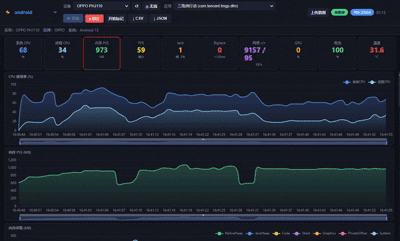

# Perfara · 性能洞察平台  
# Perfara · Performance Insight Platform

---

## 中文

### 定位

**Perfara** 是一款**开放、可私有化部署**的移动端与 PC 端性能数据平台，面向团队提供与商业闭源方案同级的可视化与分析能力——可作为 **Perfdog 等工具的免费替代思路**：数据归你、部署归你、链路透明，适合研发、测试与性能专项长期落地。

### 在线体验（Demo）

| 说明 | 链接 |
|------|------|
| **数据看板（按 UID）** | [http://106.14.56.114:8099/?uid=perfara123](http://106.14.56.114:8099/?uid=perfara123) |
| **单条测试详情（Android 示例，testid）** | [http://106.14.56.114:8099/tests?testid=8e296a067a37563370ded05f5a3bf3ec](http://106.14.56.114:8099/tests?testid=8e296a067a37563370ded05f5a3bf3ec) |

> **iOS / PC / 全平台**：列表、趋势与详情能力与上述 Demo 同源；使用同一看板入口，按项目与场景筛选即可。

### 多平台支持

- **Android** — CPU / 内存 / FPS / 卡顿 / 网络 / 温度 / 功耗等  
- **iOS & iOS GPU** — 进程 CPU、内存、帧率、磁盘与线程相关指标、GPU 细分等  
- **PC** — 与移动端同一套看板语义，便于跨端对比  

采集端上传 JSON 后，云端统一解析、图表渲染与分享。

### 界面预览（请将以下图片置于本文件同目录或 `docs/` 下）

| 文件 | 说明 |
|------|------|
| `Android1.jpg` | Android 数据展示示例 |
| `an2.gif` | Android 补充视图 |
| `web1.jpg` | Web 云端采集与数据汇聚示意 |
| `anti.jpg` | **趋势统计**：同场景多次测试的均值/峰值曲线，用于持续观测与防劣化 |





*上图：在「趋势统计」中选定项目、平台、**场景标记**与时间范围后，可对齐同一场景的多轮测试，观察 FPS、CPU、内存等随时间的走势，支撑版本对比与劣化预警。*

### 核心能力

1. **云端看板** — 浏览器内完成列表、详情、图表与指标汇总，支持按 UID 管理数据范围。  
2. **竞品比对** — 在比对页填入 **两个 testid**（分享令牌），即可并排对比关键指标，快速定位差异。  
3. **趋势统计与自动防劣化** — 为用例打上**场景标记**后，在「趋势统计」中按场景筛选；每次同场景测试在时间轴上形成趋势，便于发现性能回退与波动。  
4. **开放数据路径** — 支持自建服务、自主上传与导出；详情页可复制 testid 用于分享与集成。

### 客户端下载与采集

- **采集端 / 客户端工具说明（飞书文档）**  
  [https://my.feishu.cn/wiki/C7ClwzJvii4lCXk7e1AcWGEInSc?from=from_copylink](https://my.feishu.cn/wiki/C7ClwzJvii4lCXk7e1AcWGEInSc?from=from_copylink)

下载后按文档连接自有 **Data / Web** 服务即可上传；数据可在看板中浏览、管理与下载（具体以客户端与接口说明为准）。

### 私有化部署（服务端）

1. **依赖**：Python 3，安装 `requirements.txt`。  
2. **python需要大于python3.8**：


3. **启动（二选一）**

```bash
# 默认 0.0.0.0:8000
uvicorn backend.app:app --host 0.0.0.0 --port 8000
```

或使用项目根目录 **`serve.py`**（适合 Linux 一键启动，路径与数据库按项目根解析）：

```bash
# 修改端口示例（Windows / Linux 通用）[推荐] ，或者取serve中改端口和IP
set WEBPERF_PORT=8099
python serve.py
```

```bash
# Linux / macOS
export WEBPERF_PORT=8099
export WEBPERF_HOST=0.0.0.0
python3 serve.py
```

| 环境变量 | 说明 |
|----------|------|
| `WEBPERF_HOST` | 监听地址，默认 `0.0.0.0` |
| `WEBPERF_PORT` | 监听端口，默认 `8000` |
| `WEB_PERF_DB` | SQLite 数据库文件绝对路径；未设置时默认为 `<项目根>/data/webperf.db` |

浏览器访问 `http://<主机>:<端口>/`；API 为同源 `/api/*`。更完整的接口与上传格式见仓库内 **`README.md`**。

### 便携式 EXE（Windows 免安装）

不需要 Python 环境，单个 exe 双击即用（内置后端 + 前端页面 + 图表配置）。

```bash
# 打包（需本机装过 Python 3.9+；Windows 双击 build_exe.bat 亦可）
pip install -r requirements.txt pyinstaller
pyinstaller perfara.spec --noconfirm --clean
# 产物：dist/Perfara.exe
```

使用：

| 操作 | 说明 |
|------|------|
| 双击 `Perfara.exe` | 启动服务并自动打开浏览器（默认 `http://127.0.0.1:8000/`） |
| `Perfara.exe --port 8099` | 指定端口；端口被占用时自动顺延 |
| `Perfara.exe --host 0.0.0.0` | 允许局域网访问（默认仅本机） |
| `Perfara.exe --no-browser` | 不自动打开浏览器 |
| `Perfara.exe --data-dir D:\perfara-data` | 指定数据目录 |

- **数据位置**：exe 同目录的 `data/webperf.db`（首次运行自动初始化）与 `logs/app.log`；整个文件夹拷走即可迁移，升级 exe 不会覆盖已有数据。
- 启动后浏览器打开 `http://127.0.0.1:8000/?uid=perfara123` 可直接看演示数据；正式使用请换成自己的 UID。
- 关闭控制台窗口即停止服务。

### 私有化部署（采集端指向自有看板）

将采集客户端解压或安装后，编辑：

`resources/configout/config.js`

将其中 **开放 Data / Web 服务地址** 改为你方部署的看板根 URL（与浏览器访问地址一致，含协议与端口），保存后重启客户端，即可向自有环境上报数据。

### 开源与仓库

- **私有化 / 自建参考**： [https://github.com/codinghiker/perfara](https://github.com/codinghiker/perfara)

---

## English

### Positioning

**Perfara** is an **open, self-hostable** performance data platform for mobile and PC workloads—offering visualization and analysis comparable in spirit to commercial closed-source stacks. It serves as a **free, transparent alternative** to tools like **Perfdog**: your data, your deployment, your pipeline—ideal for engineering, QA, and long-term performance programs.

### Live Demo

| Description | Link |
|-------------|------|
| **Dashboard (by UID)** | [http://106.14.56.114:8099/?uid=perfara123](http://106.14.56.114:8099/?uid=perfara123) |
| **Single test detail (Android sample, `testid`)** | [http://106.14.56.114:8099/tests?testid=8e296a067a37563370ded05f5a3bf3ec](http://106.14.56.114:8099/tests?testid=8e296a067a37563370ded05f5a3bf3ec) |

> **iOS / PC / all platforms** — Listing, trends, and detail views share the same stack as the demo; open the dashboard URL and filter by project and scenario.

### Multi-platform

- **Android** — CPU, memory, FPS, jank, network, thermal, power, and more  
- **iOS & iOS GPU** — Process CPU, memory, frame pacing, disk & scheduling-related metrics, GPU breakdowns  
- **PC** — Same dashboard semantics as mobile for cross-platform benchmarking  

Upload performance JSON to your server; the cloud parses, charts, and shares results.

### Screenshots

Place these next to this file or under `docs/`:

| File | Description |
|------|-------------|
| `Android1.jpg` | Android dashboard sample |
| `an2.gif` | Additional Android view |
| `web1.jpg` | Web-side collection & aggregation |
| `anti.jpg` | **Trends**: mean vs peak curves across runs for the same scenario |


*Select project, platform, **scenario tag**, and date range under **Trends** to align multiple runs of the same scenario and track FPS, CPU, memory over time—ideal for release comparison and anti-regression.*

### Highlights

1. **Cloud dashboard** — Lists, details, charts, and summaries in the browser; UID-scoped data access.  
2. **Competitor / A-B compare** — Enter **two `testid` tokens** on the compare page for side-by-side metrics.  
3. **Trends & anti-degradation** — Tag scenarios on each run; filter by scenario in **Trends** to see evolution and catch performance drift early.  
4. **Open data path** — Self-host, upload, and export; copy `testid` from detail pages for sharing and automation.

### Client download & capture

- **Client tooling & capture guide (Feishu doc)**  
  [https://my.feishu.cn/wiki/C7ClwzJvii4lCXk7e1AcWGEInSc?from=from_copylink](https://my.feishu.cn/wiki/C7ClwzJvii4lCXk7e1AcWGEInSc?from=from_copylink)

Point the client at your own **Data / Web** endpoint after deployment. Browse, manage, and download data from the dashboard per your workflow.

### Self-hosting (server)

1. **Prerequisites**: Python 3 and `requirements.txt`.  


2. **Run (pick one)**

```bash
uvicorn backend.app:app --host 0.0.0.0 --port 8000
```

Or use **`serve.py`** at the repo root:

```bash
set WEBPERF_PORT=8099
python serve.py
```

```bash
export WEBPERF_PORT=8099
export WEBPERF_HOST=0.0.0.0
python3 serve.py
```

| Variable | Purpose |
|----------|---------|
| `WEBPERF_HOST` | Bind address (default `0.0.0.0`) |
| `WEBPERF_PORT` | Port (default `8000`) |
| `WEB_PERF_DB` | Absolute path to SQLite file; default `<repo>/data/webperf.db` |

Open `http://<host>:<port>/`; APIs are same-origin under `/api/*`. See **`README.md`** in the repository for full API and upload schema.

### Portable EXE (Windows, no install)

Single-file executable bundling backend + built frontend + chart configs — no Python required.

```bash
pip install -r requirements.txt pyinstaller
pyinstaller perfara.spec --noconfirm --clean
# output: dist/Perfara.exe
```

- Double-click `Perfara.exe` → starts the server and opens `http://127.0.0.1:8000/`.
- Flags: `--port`, `--host 0.0.0.0` (LAN access), `--no-browser`, `--data-dir <path>`.
- Data lives next to the exe in `data/webperf.db` and `logs/app.log`; copy the whole folder to migrate, and upgrading the exe never overwrites existing data.
- Close the console window to stop the service.

### Self-hosting (client → your server)

Edit:

`resources/configout/config.js`

Set the **public Data / Web base URL** to your deployed dashboard root (scheme, host, and port). Restart the client to report to your environment.

### Repository

- **Reference / self-host**: [https://github.com/codinghiker/perfara](https://github.com/codinghiker/perfara)

---

*Perfara — Measure. Visualize. Stay in control.*
