# Perfara 操作手册（采集 · 报告 · 弱网）

适用包：`Perfara_Portable_20261029_r9`（Windows 便携版，解压即用，无需安装）。
文中截图均来自真机实测；序列号与本机绝对路径已在配图中隐去。

---

## 一、启动与主界面

解压发布包后，双击根目录的 `Perfara.exe`。启动器会：

1. 在 `127.0.0.1` 上拉起本地服务（看板 `http://127.0.0.1:8000/?uid=perfara123`，端口被占用时自动换一个并打印在窗口里）；
2. 打开采集窗口（采集窗口是独立的 Electron 程序，关掉它不会停服务）。

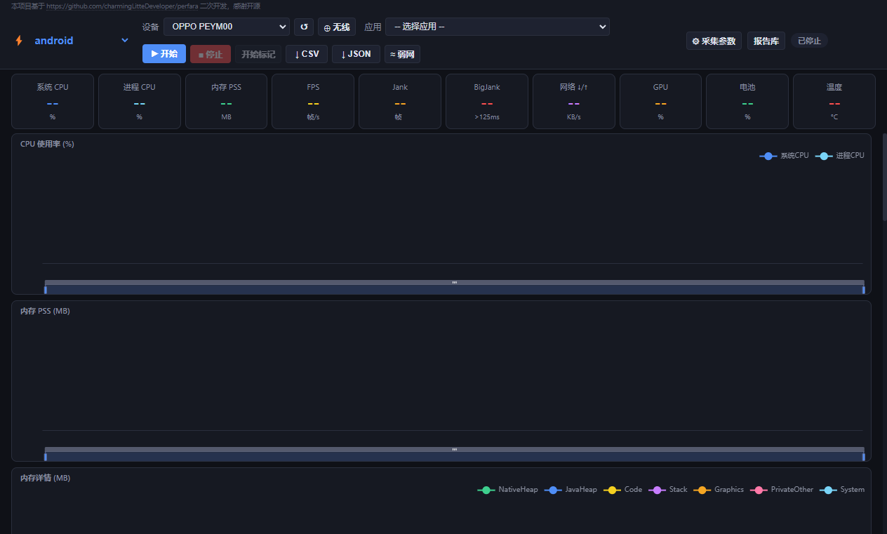

窗口分四块：

| 区域 | 内容 |
| --- | --- |
| 顶栏左侧 | 设备下拉、刷新、`无线` 连接、应用下拉，以及采集按钮组：`开始 / 停止 / 开始标记 / CSV / JSON / ≈ 弱网测试` |
| 顶栏右侧 | `采集参数`、`报告库`、采集状态徽标、采集进程 PID 与计时 |
| 指标卡 | 系统 CPU、进程 CPU、内存 PSS、FPS、Jank、BigJank、网络 下行/上行、GPU、电池、温度 |
| 图表区 | CPU 使用率、内存 PSS、内存详情等曲线；底部为「低谷截图」缩略图条 |

初次打开时应用未选择、指标全部为 `--`，属于正常状态。

> 本项目基于 [CharmingLiteDeveloper/perfara](https://github.com/CharmingLiteDeveloper/perfara) 二次开发，遵循其开源协议；窗口左上角常驻该署名。

## 二、连接设备与选择应用

- **USB**：手机开启「开发者选项 → USB 调试」，用数据线连接电脑；点顶栏 `↻` 刷新即可看到设备。
- **无线**：手机与电脑在同一局域网时点 `无线`，按提示 `adb connect <手机IP>:<端口>`；无线链路抖动会直接影响采样，正式测试建议 USB。

设备出现后，在「应用」下拉里选择被测应用。列表显示的是手机桌面上的应用名，
后面括号里是包名，例如 `示例应用 (com.example.app)`。

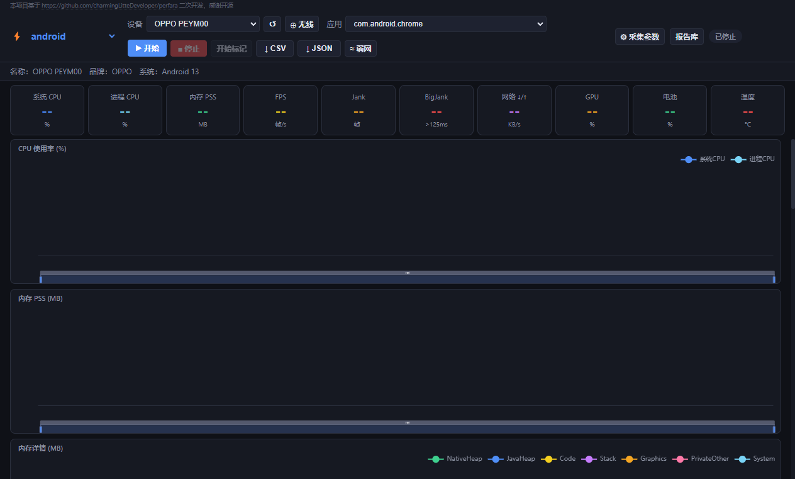

- 名字由客户端从每个应用的安装包里读出来（手机端没有现成的应用名接口），
  首次接新手机要后台逐条解析 1~2 分钟，期间列表先显示包名，解析出一个就更新一个；
- 解析完成后列表按中文名排序一次，选中的应用保持不变；
- 结果按「包名 + 版本号 + 手机语言」缓存到本机，之后打开同一台手机立刻就有名字；
- 采集中解析会暂停（exec-out 读安装包会占 USB 带宽，影响采样），采集结束后自动继续。

## 三、开始采集

点 `开始`。如果当前设备 + 应用已经有采样点，会先弹出「已有采集数据」：

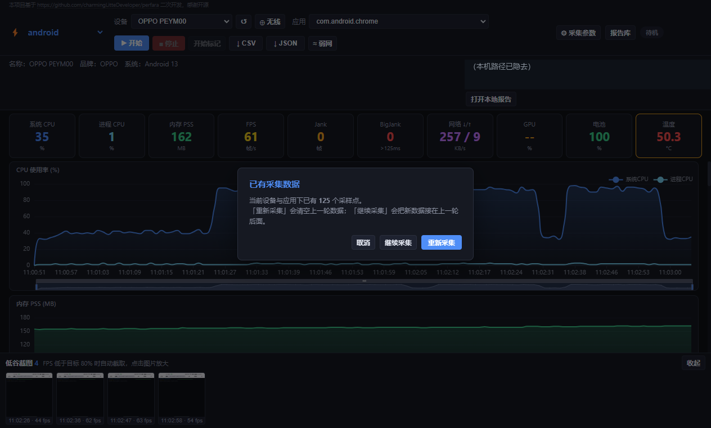

- `继续采集`：把新数据接在上一轮后面（同一份报告，适合分段测试）；
- `重新采集`：清空上一轮数据，重新开始；
- `取消`：什么都不做。

采集开始前请把被测应用切到前台并点亮屏幕，否则 FPS 取不到（见「常见问题」）。

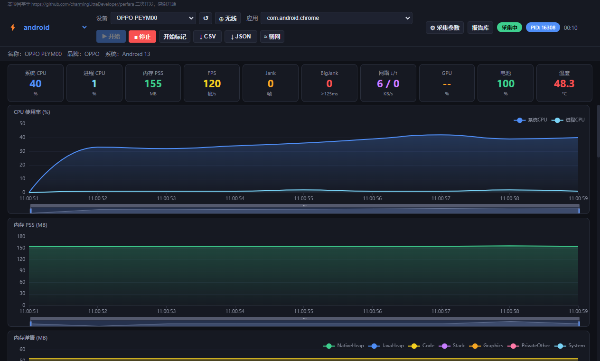

指标卡每秒刷新；曲线区可横向拖动时间轴。点 `开始标记` 可在时间轴上打一个标记，便于回看。

## 四、低谷自动截图

采集过程中，若 FPS 连续低于「目标帧率（屏幕刷新率的 P95）」的 80%，会自动截一张手机屏幕图；相邻截图有冷却时间且有张数上限，避免刷屏。

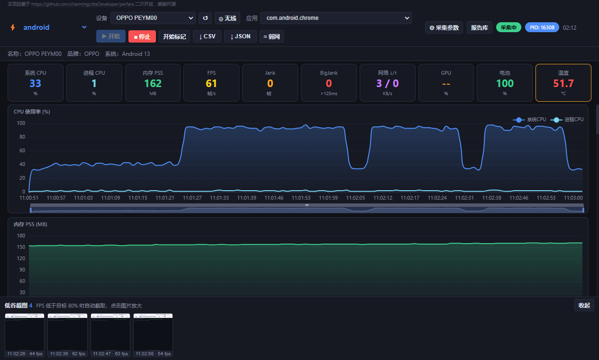

- 底部「低谷截图 N」条里按时间排列，每张带 `时间 · FPS`；
- 点缩略图可在窗口内放大查看，`Esc` 或点击遮罩关闭；
- 右侧 `收起` 可折叠截图条，给图表让出空间。

## 五、停止采集与本地报告

点 `停止` 后采集结束，本轮数据落盘并归档到本地报告目录：

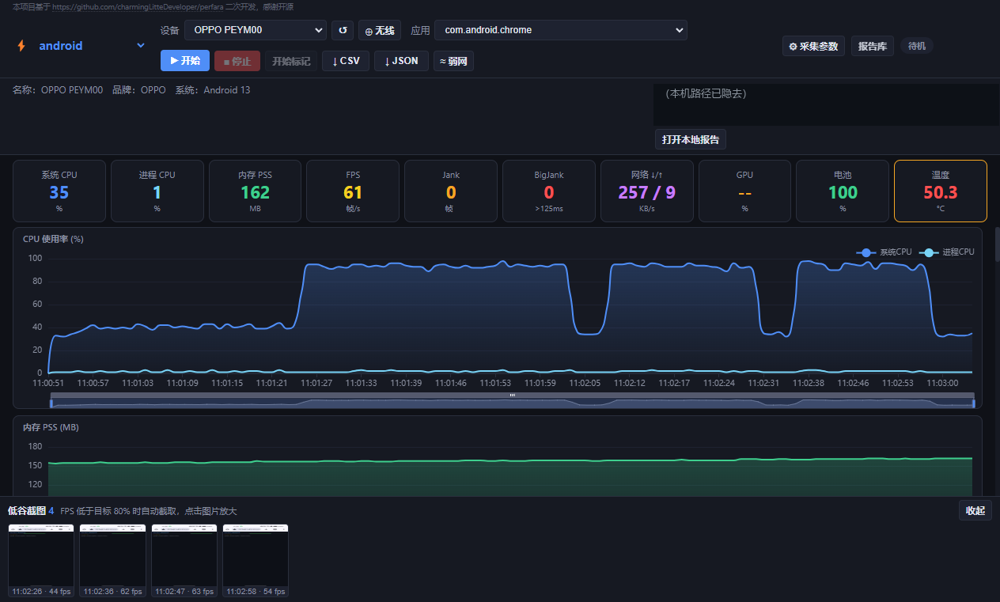

- 右侧显示本机报告目录与 `打开本地报告` 按钮（路径随机器不同，配图中已隐去）；
- 报告默认文件名 `perf.html`，由「停止」时自动生成；
- 停止后指标卡保留最后一次数值，可继续查看曲线。

## 六、采集参数（少采 / 不采某些指标）

点顶栏 `采集参数`：

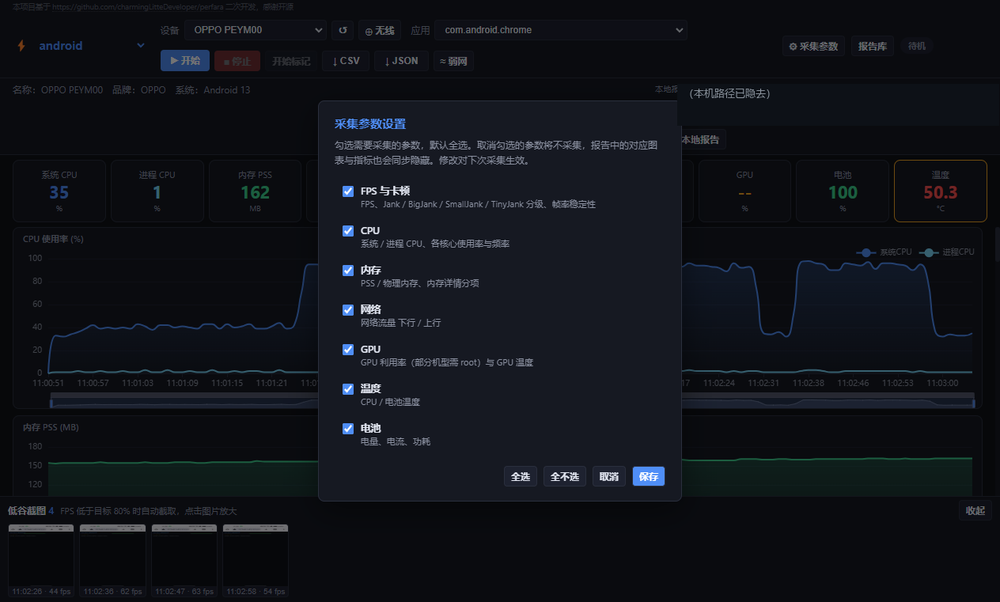

- 默认全选；`全选 / 全不选 / 取消 / 保存`；
- 取消勾选的指标：**不再采集**（安卓端直接跳过对应 adb 调用）、**界面卡片与曲线隐藏**、**报告页对应图表与指标行隐藏**；
- 修改对下一次采集生效，已生成的报告不受影响；报告库卡片会标注「已移除参数：网络」。

例如取消「网络」后再采集，网络卡片不再提供数据：

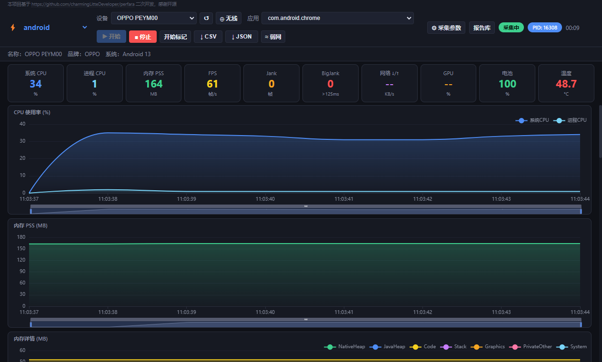

## 七、报告库

点顶栏 `报告库`，用系统浏览器打开本地报告列表（数据都在本机，不联网）：

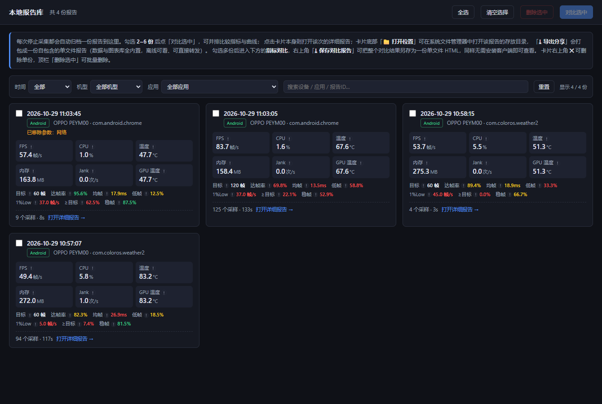

- 每次「停止」都会自动归档一份报告，卡片显示关键指标与「已移除参数」；
- 勾选 2–6 份后点 `对比选中`，可并排比较指标与曲线；
- 卡片底部：`打开位置`（在资源管理器中定位）、`导出分享`（打包成单文件 HTML，离线可看）、`打开详细报告`；
- 右上角 `保存对比报告` 可把当前对比另存为单文件 HTML；`删除选中` 批量清理。

## 八、报告页

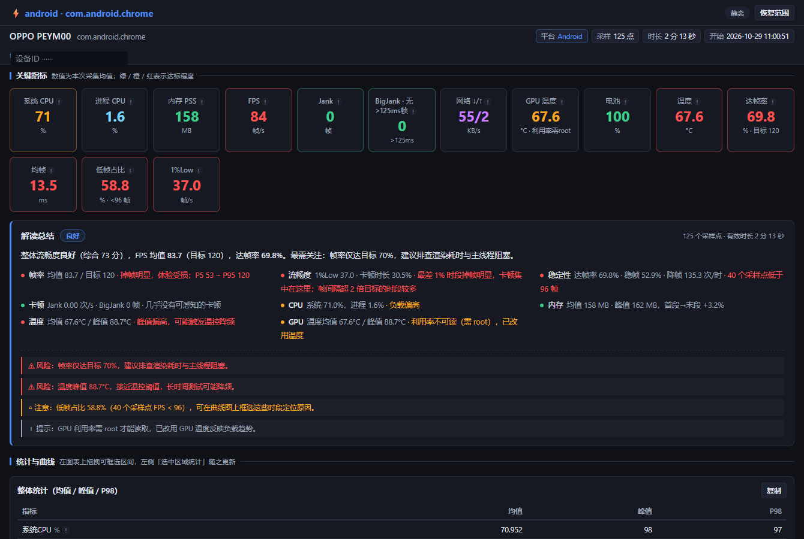

- 顶部：机型、应用、平台，采样点数、有效时长、开始时间；
- 关键指标卡：均值/峰值之外的 `达帧率`、`均帧`、`低帧占比`、`1% Low` 等统计；
- 解读总结：综合评分、主要风险（帧率、卡顿、温度、CPU）与逐条建议；
- 向下是 `统计与曲线`（可框选区间看分段统计）与低谷截图画廊。

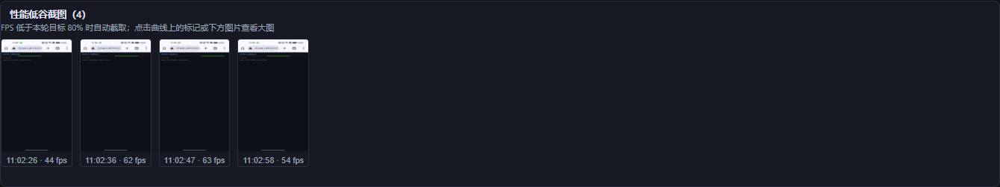

## 九、弱网测试（WeakNet）

> 版本说明：`r8` 起 `≈ 弱网测试` 是采集窗口内的二级页面；`r7` 及更早是拉起 WeakNet 独立窗口的旧版，界面与本节目不同。`r9` 起手机接管改为纯 USB（`adb reverse` + 手机系统代理），不需要在手机上装 WeakNet APK。

### 9.1 入口与界面

`≈ 弱网测试` 与 `开始 / 停止 / 开始标记 / CSV / JSON` 在同一行，点击后在采集窗口内打开弱网测试页（覆盖式，不另开窗口）：

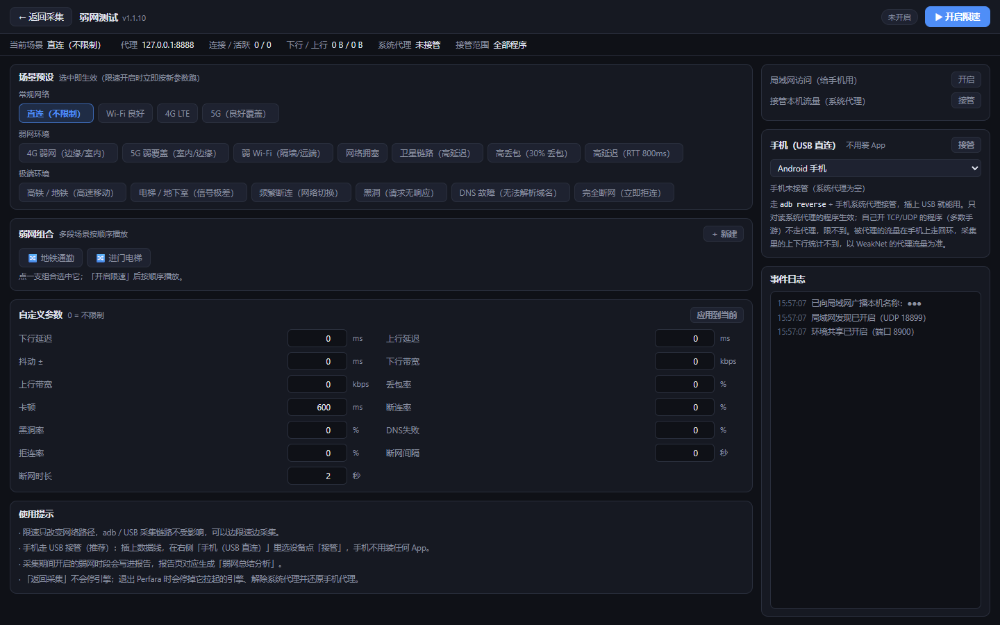

- 弱网引擎（WeakNet）以无界面方式随 Perfara 启动，界面由 Perfara 自己绘制；页面里的控制请求经主进程转发，端口与进程都由主进程接管；
- 代理默认监听 `127.0.0.1:8888`，控制接口 `http://127.0.0.1:8899`；端口被占用时自动顺延，以状态条显示的地址为准；
- 状态条从左到右：当前场景、代理地址、连接数/活跃数、上下行流量、系统代理是否被接管、接管范围；
- 右栏：`跟随性能采集`（见 9.1 下面的说明）、局域网访问、接管本机流量、手机（USB 直连）——手机那一块选好设备点 `接管` 即可，手机不用装 App；
- 内置 17 个场景分三档：常规网络（直连、Wi-Fi 良好、4G LTE、5G）、弱网环境（4G 弱网、5G 弱覆盖、弱 Wi-Fi、网络拥塞、卫星链路、高丢包、高延迟）、极端环境（高铁/地铁、电梯/地下室、频繁断连、黑洞、DNS 故障、完全断网）；点场景即时生效，正在限速时会立刻按新参数跑；
- 左栏第三块是「弱网组合」：把几段场景排成一条链按时长自动切换，用法见 9.3；
- 自定义参数 13 项：上下行延迟、抖动、上下行带宽、丢包率、断连率/断连间隔/断连时长、卡顿、黑洞率、拒连率、DNS 故障率，`0` = 不限制；改完点 `应用到当前`；
- 点 `▶ 开启限速` 后胶囊变 `限速中`、按钮变 `■ 停止限速`，事件日志按时间记下每次切换：

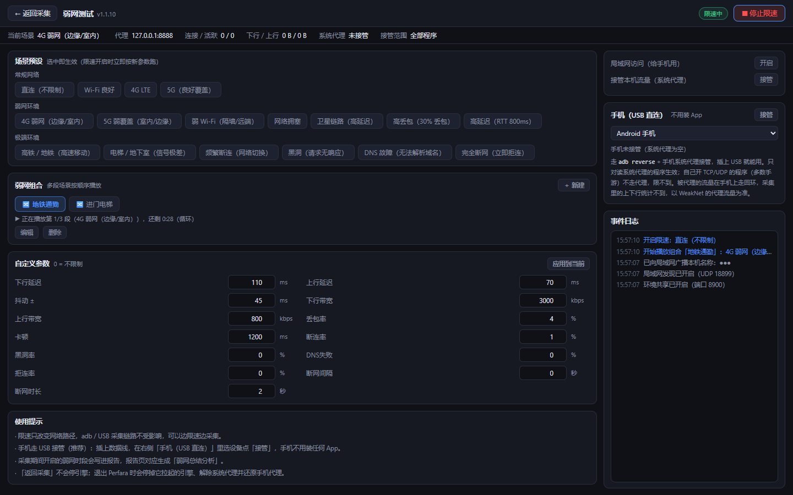

- `▶ 开启限速` 是页头唯一的启停按钮，点它会一次做完：确保引擎可用 → 接管下拉框里选中的手机（没选手机就只限本机）→ 按当前选中的场景/组合开启限速，结果写在页面提示条里；手机接管失败只提示、限速照开，限速没开成则把刚接管的手机退回去。限速中同一个按钮变 `■ 停止限速`，只停限速，场景 / 代理 / 手机接管都保留，随时能再开；
- `跟随性能采集`（右栏开关，关闭 = 默认）：开启后不用再手动开弱网，点采集主界面的 `开始` 时会先接管当前设备并开启限速，再开始采样，保证第一帧就在弱网里；停止采集（含切设备/换应用、应用退出或设备卡死触发的自动停止、启动失败回滚）时把限速、系统代理、手机代理一起收掉。开关状态会记住，只开跟随时顶栏显示蓝色的 `≈ 弱网·跟随`；

- `← 返回采集` 只关页面，不停引擎、不停限速；此时顶栏按钮变成绿色的 `≈ 限速中`，回到采集界面也知道现在还限着；
- 限速期间顶栏会多出 `⏸ 暂停弱网`、`■ 停止弱网` 两个快捷按钮，不用再进二级页面：`暂停弱网` 只关限速、场景 / 系统代理 / 手机接管全部保留（按钮变 `▶ 继续弱网`，顶栏显示橙色的 `≈ 已暂停`）；`停止弱网` 把限速、系统代理、手机代理一次收干净，顶栏留一行绿色的「弱网已停止」，明细同时写进日志面板；
- 退出 Perfara 时会先关限速、解除系统代理再结束引擎，不会把本机留在断网状态；引擎意外退出时页面顶部会给出提示，重新点 `开启限速` 即可再拉起。

### 9.2 接管谁：本机 / 局域网 / 手机

| 接管对象 | 做法 | 说明 |
| --- | --- | --- |
| 本机桌面程序 | 右栏 `接管本机流量（系统代理）` → `接管` | 写 Windows 系统代理指向 `127.0.0.1:8888`；关闭 Perfara 时自动解除。开启前会把注册表原值快照到用户目录：引擎崩溃 / 被强杀时按快照还原，整个程序被强杀的话下次启动会先还原再开窗口 |
| 安卓手机（USB 直连，推荐） | 数据线连上电脑 → 右栏 `手机（USB 直连）` 选设备 → `接管` | 只用 adb：`adb reverse` 把手机 `127.0.0.1:18888` 接到本机引擎 `8888`，再把手机系统代理指到 `127.0.0.1:18888`。**手机不装任何 App**；引擎没起时点 `接管` 会自动把它拉起来（不用先点 `开启限速`）；接管时自动开启限速，点 `解除` 或退出 Perfara 会还原手机代理并撤掉映射。接管成功后手机会装一个守护脚本，拔线后自动恢复直连 |
| 同一 Wi-Fi 的手机 / 其他设备 | 右栏 `局域网访问` → `开启`，设备上把 HTTP 代理设为 `PC 的 IP:8888` | 不用装任何东西；USB 不可用时可以先试这个 |

- 只有走代理的流量会被限速：应用自带 QUIC、或直接连 IP 不走系统代理，会绕开弱网。USB 接管受同一条边界限制，自己开 TCP/UDP 的程序（多数手游）不走系统代理，限不到；
- 如果手机原本就配着系统代理（公司 Wi-Fi 之类），`接管`会先把它记下来、换成 `127.0.0.1:18888`，`解除`时按原值写回，不会把原来的配置删掉；手机上的代理不是本工具设置的，页面会显示原值并说明，不会显示成「已接管」；
- 部分 ROM 禁止 adb 写系统设置，接管会被拒绝，页面会直接说明原因：到「开发者选项」打开 `禁止权限监控` 或 `USB 调试（安全设置）`（不同厂商叫法不同，两个都没有说明该 ROM 不支持），然后重新点 `接管`；
- USB 接管的手机被限速时，限速跑在本机引擎上，报告里的弱网来源会记成「手机」，不是「本机」；
- 拔数据线不用先点 `解除`：接管成功后会在手机上起一个守护脚本，每 2 秒检查一次 `18888` 的反向监听，发现监听消失（拔线 / adb 断开）就自己清掉系统代理——先写 `:0`（顺带清掉 MIUI 镜像进 Wi-Fi 网络配置的那份），再删 `global_http_proxy_host/port` 与 `http_proxy`，几秒内恢复直连，不会出现「拔了线还上不了网」。手机状态里会写明「拔线后手机会自动恢复直连」；极少数 ROM 装不上守护时会显示「拔线守护未安装」，这时请先点 `解除` 再拔线；
- 接管/解除都按「已经接管的那台 + 端口」记账，不看下拉框当前选中项：接管 A 之后把下拉框切到 B，再点 `解除`，清掉的仍是 A；此时页面会提示「另一台手机还挂着代理」。换机接管、或改了端口重新接管，都会先把上一台还原，旧映射和旧代理不会留到拔线；
- 自动还原失败时（手机已被拔掉、ROM 拒写等），按提示手动处理：手机「设置 → WLAN → 代理」改成「无」，或执行 `adb shell settings put global http_proxy :0`。**不要用 `settings delete global http_proxy`**——只删全局那一行清不掉 MIUI 镜像进网络配置的副本，手机照样上不了网；
- 手机重启后代理仍在，但反向映射和拔线守护都没了，重启到重新点 `接管` 之间手机会短暂上不了网——重新接一次即可恢复；手边没有电脑时用上面那条 `:0` 命令或手机 WLAN 设置清掉；
- 采集程序被任务管理器强杀 / 蓝屏重启时，内存里的账本跟着没了，但手机上的代理还在：重新打开 Perfara 会做一次启动自检——只对「代理指着 `127.0.0.1:18888` 且 `reverse --list` 里已经没有这条映射」的手机清代理；映射还在（说明限速可能还在用）或代理不是本工具写的，一律不碰；
- 随包还带着原来的 `WeakNet.exe` 图形界面（`collector/resources/weaknet/WeakNet.exe`），单独排查问题时可双击打开：

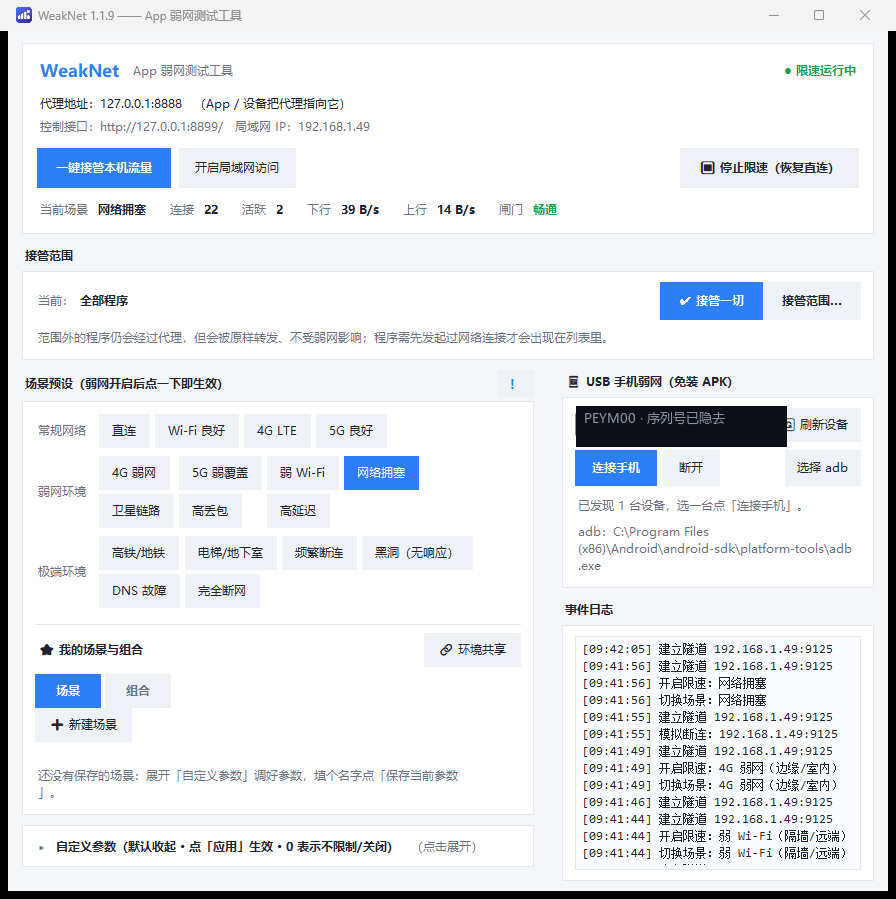

> Perfara 已经拉起引擎时再双击它，只会提示「已经有一个 WeakNet 实例在运行」——同一个端口不能起两份，这时候请直接用 Perfara 里的弱网测试页。

### 9.3 弱网组合

单个场景只能模拟「一直很难用」，真实用户遇到的是「好一段、差一段」。弱网组合把几段场景排成一条链，引擎按每段的时长自动切换：

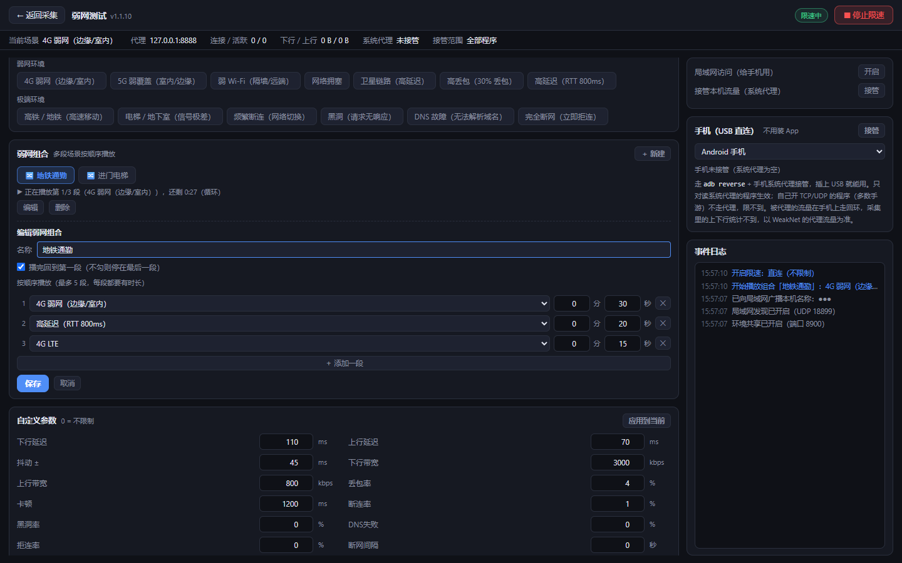

- 左栏「弱网组合」卡片里点一支组合选中它，`开启限速` 后从第一段开始按序播放；没开限速时只选中，不会偷偷开始；
- `＋ 新建`：填名称、勾不勾循环、逐段选场景并填分 / 秒（最多 5 段，单段最长 600 分 59 秒），`保存` 后直接出现在列表里；
- 播放期间卡片下方实时显示 `▶ 正在播放第 2/4 段（场景名），还剩 1:20（循环）`，状态条的「当前场景」也跟着变；播完不勾循环就停在最后一段（不是自动回直连），勾了循环就一直转；
- 选中一支组合后才会出现 `编辑` / `删除`；删除要按两下（第一下变 `确认删除`），删掉正在播的组合会停播放回直连；
- 组合与 WeakNet 图形界面共用同一份配置：图形界面里建的组合这里能直接看到、直接用；
- 组合不能嵌套（段里不能再选一支组合）；某一段引用的场景被删掉时，引擎跳过这一段继续往后播，不会整条链崩掉。

边播组合边采集时，报告「弱网总结分析」会按段拆成多条时段——每段一个场景、各自一段开始结束时间，正好能和帧率曲线对上。

### 9.4 与采集同时使用

弱网只改变接管对象的网络路径（本机走系统代理、手机走 USB 反向映射 + 手机系统代理），adb 采集链路不受影响；可以边限速边采集，观察应用在弱网下的帧率与流量变化：

- 采集端连本机服务、adb 都走 `127.0.0.1`，系统代理的绕过列表包含 `localhost;127.*;<local>`，不会被接管劫持；接管本机流量时看板、上传、报告照常可用；
- 手机被 USB 接管时，程序流量经 `127.0.0.1:18888`（回环）进本机引擎，手机的 `wlan0/rmnet` 计数器看不到这部分 —— 采集里的「上/下行」会明显偏低，甚至接近 0，这是口径问题不是丢包；真实代理流量看「弱网总结分析」里的代理流量，或有线网卡/引擎统计；
- 采集中途接管/解除手机，报告里的来源会按切换时刻拆段（前一段记本机、后一段记手机），不需要重开采集；
- 万一引擎崩了/被手动关掉，Perfara 会先把手机代理还原再提示，不会把手机留在「代理指向死端口」的断网状态；

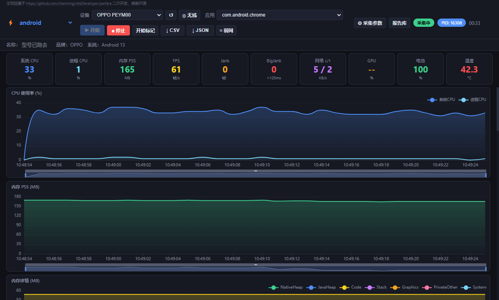

手机端效果（弱 Wi-Fi 场景，256 KB 文件连续下载）：

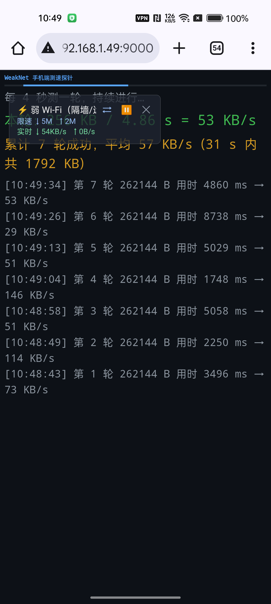

实测对照（同一 256 KB 文件、同一手机同一页面）：4G LTE 场景平均 867 KB/s → 弱 Wi-Fi 场景平均 57 KB/s、单轮 1.7–8.7 s；4G 弱网场景还会注入模拟断连，请求失败属于预期效果。

### 9.5 报告里的弱网总结分析

**采集期间处于限速状态时**，停止后生成的 `perf.html` 会在「解读总结」下方多出一块 `弱网总结分析`：

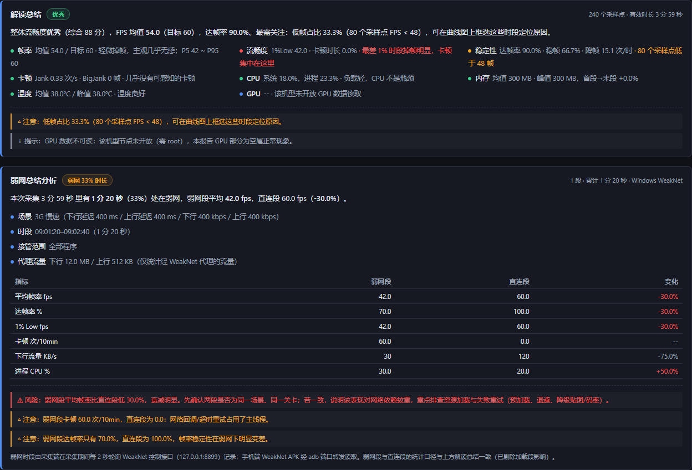

> 此图为演示数据渲染（设备名与包名均为虚构），用于说明版块结构。

版块自上而下：

- **徽标**：弱网时长占全程的比例；右侧小字给段数、累计时长与来源（`Windows WeakNet` / `手机（USB 接管）`）；
- **一句话结论**：全程多长、其中多少在弱网（占比）、弱网段与直连段的平均帧率及变化；
- **明细**：场景（只列真正生效的参数，`0` 值不写）、时段（每段起止与时长）、接管范围（全部程序 / 指定 N 个程序）、代理流量（仅统计经 WeakNet 转发的上下行）；
- **对比表**：平均帧率、达帧率、1% Low、卡顿、下行流量、进程 CPU 六项，弱网段 vs 直连段，外加变化百分比。绿=变好、红=变差、灰=中性（流量随限速下降是必然结果，不判好坏）；
- **风险与建议**：按帧率衰减幅度、卡顿倍数、达帧率下滑、弱网时长过短、缺少直连基线分别给结论。

口径：

- 采集端在采集期间**每 2 秒**轮询 WeakNet 控制接口（默认 `127.0.0.1:8899`，端口顺延时以引擎握手回传的为准）；USB 接管的手机走的就是这个引擎，不需要在手机上再起一份；
- 段按场景切分：中途换场景 / 改参数会另起一段；中途关掉再开记成两段，报告里「同名同参数」的段合并成一条场景展示；
- 与上方「解读总结」同一套统计口径：FPS 相关指标先剔除加载段再算；
- 采集结束时限速仍开着，最后一段算到「停止」那一刻；
- 全程都在弱网里时没有直连基线，对比表的直连列显示 `--`，只给绝对值；
- 没开弱网、或 WeakNet 全程没连上，这一块不会出现，报告其余部分不受影响。

## 十、常见问题

| 现象 | 原因与处理 |
| --- | --- |
| FPS 一直是 `--` | 被测应用不在前台、屏幕熄灭或无画面刷新。切到前台、点亮屏幕后重新采集 |
| GPU 一直 `--` | GPU 利用率需要 root，普通机型只显示 GPU 温度 |
| 采集过程中提示「连续 N 秒未取到帧数据」 | 同上，应用被切到后台；回到应用即可恢复 |
| 报告打不开 | `perf.html` 由「停止」生成，未停止过就没有报告；先停止再点「打开本地报告」 |
| 报告里设备 ID / 路径想分享 | 报告页包含设备序列号与本机路径，分享前请打码（本手册配图已隐去） |
| 弱网不生效 | 看接管对象对不对：本机接管要状态条 `系统代理` 显示「已接管」；手机要状态栏有 VPN 钥匙图标，或手机 Wi-Fi 代理指向了 `PC 的 IP:8888`。再看状态条的场景与连接数有没有变化 |
| 弱网测试页提示「引擎未启动」 | 提示条会给出原因：版本过旧、进程退出、端口起不来。版本过旧说明随包的 `WeakNet.exe` 还是旧版（不支持 `--headless`），重新打包收集端即可；开发模式下把 `PERFARA_WEAKNET_SRC` 指向 WeakNet 源码，会直接跑 Python 引擎 |
| 点了「开启限速」连接数一直是 0 | 说明没有流量经过 WeakNet：本机没接管系统代理，或者程序不走系统代理（自带 QUIC / 直连 IP） |
| 报告里没有「弱网总结分析」 | 说明采集期间没有记录到限速：WeakNet 需在采集**期间**处于限速中（看状态条场景不是 `直连（不限制）`、胶囊是「限速中」；手机接管要在采集期间仍处于「解除」状态）。若弱网时段整段落在采样区间之外（先开弱网很久才点开始），同样不会显示 |
| 无线连接频繁掉线 | 改 USB；无线受路由器与信道影响，采样间隔会抖动 |
